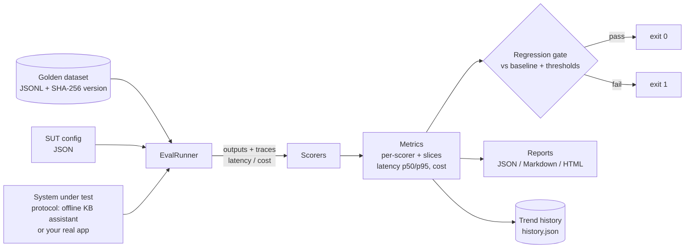

# Automated LLM Evaluation Pipeline

A CI-grade evaluation harness for LLM applications: versioned golden
datasets, pluggable systems under test, a bundle of deterministic
scorers (lexical, semantic, groundedness/citation, rubric LLM-as-judge),
regression gating against a baseline, human-readable reports, and a
trend history — all runnable **offline with no API keys**.

> The bundled demo evaluates a small retrieval assistant over a
> synthetic retail help-center knowledge base. Baseline configuration:
> overall mean **0.885**. A deliberately regressed configuration
> (truncated answers, dropped citations, noisy retrieval): **0.084** —
> and the gate fails the build, which is the point.

## The problem

LLM applications regress silently. A prompt tweak, a model swap, or a
retrieval change can quietly degrade answer quality for one slice of
traffic while aggregate vibes stay positive. Teams that ship LLM
features need the same discipline they apply to ordinary software:

1. A **golden dataset** that is versioned and reviewable like code.
2. **Repeatable runs** of the exact system configuration being shipped.
3. **Scorers** that measure more than string overlap — grounding and
   citations included.
4. A **gate**: if quality drops beyond agreed thresholds versus the
   baseline, CI fails *before* users notice.
5. **History**: every run recorded, so trends are visible over time.

This project implements that loop end to end, in the small, with clean
extension points for real models and real applications.

## Architecture



| Component | Module | Responsibility |
|---|---|---|
| Schemas | `schemas.py` | Pydantic models for cases, outputs, scores, reports, thresholds |
| Datasets | `dataset.py` | JSONL load/validate, canonical encoding, content-hash versioning |
| Embedder | `embedder.py` | Deterministic local hashed-ngram embeddings + cosine similarity |
| SUT | `sut.py` | `SystemUnderTest` protocol; offline knowledge-base assistant |
| Scorers | `scorers.py` | Exact, regex, semantic, groundedness, rubric judge (+ offline stub) |
| Engine | `runner.py` | Execute SUT per case, score, isolate SUT/scorer failures |
| Metrics | `metrics.py` | Per-scorer aggregates, tag slices, latency percentiles, cost |
| Gating | `gating.py` | Baseline comparison with min-score / max-drop / latency / cost rules |
| Reports | `report.py` | Markdown + self-contained HTML rendering |
| History | `history.py` | Append-only JSON trend log |
| CLI | `cli.py` | `validate-dataset`, `run`, `demo`, `history` |
| API | `api.py` | Optional FastAPI surface (`/runs`, `/score`, `/history`, …) |

See [`docs/architecture.md`](docs/architecture.md) for design details
and extension points.

## Quickstart

```bash
python -m venv .venv && source .venv/bin/activate
pip install -e ".[api,dev]"        # or: pip install -r requirements.txt

# 1. The two-minute demo: baseline passes its gate, regressed config fails it
llm-eval demo --out demo-out
#    (equivalently: python -m llm_eval_pipeline.cli demo)

# 2. Validate the bundled golden dataset and print its version fingerprint
llm-eval validate-dataset data/golden/support_qa_v1.jsonl

# 3. Tests
pytest
```

## Usage

### Run an evaluation and gate it against a baseline

```bash
# Produce the baseline report (e.g. from the current production config)
llm-eval run --config examples/sut_config_baseline.json --out out/baseline

# Evaluate a candidate config; exit code is 1 if the gate fails
llm-eval run --config examples/sut_config_regressed.json --out out/candidate \
    --baseline out/baseline/report.json \
    --thresholds examples/thresholds.json \
    --history out/history.json

# Review trends
llm-eval history out/history.json
```

Every `run` writes `report.json` (full fidelity), `report.md`, and
`report.html` (self-contained, no external assets) to the output dir.

### Gate thresholds (`examples/thresholds.json`)

```json
{
  "min_scores":   {"groundedness": 0.8, "regex_match": 0.9, "semantic_similarity": 0.6},
  "max_drop":     {"groundedness": 0.03},
  "default_max_drop": 0.05,
  "max_latency_p95_ms": 1500,
  "max_total_cost_usd": 0.05
}
```

The gate fails when a scorer mean is below its minimum, drops versus
baseline beyond its allowance, p95 latency exceeds the cap, total cost
exceeds the cap, or any case errored in the SUT.

### Golden dataset format (JSONL, one case per line)

```json
{"id": "returns-window",
 "input": "How many days do I have to return an unused item?",
 "expected_output": "You can return any unused item within 30 days of delivery for a full refund.",
 "expected_patterns": ["30 days", "refund"],
 "reference_facts": ["return any unused item within 30 days of delivery"],
 "available_docs": ["returns-policy", "shipping-info"],
 "tags": {"category": "returns", "difficulty": "easy"}}
```

The dataset version is a SHA-256 over the canonical encoding of the
cases: any semantic edit mints a new fingerprint, so a report always
names exactly the dataset it was produced from.

### Scorers

| Scorer | Signal | Notes |
|---|---|---|
| `exact_match` | Normalized equality with the reference answer | Strict; useful for short factual answers |
| `regex_match` | Fraction of required patterns present (pass = all) | Cheap must-contain assertions |
| `semantic_similarity` | Embedding cosine vs reference (default threshold 0.35) | Local deterministic embedder; swap in a real model via the `Embedder` protocol |
| `groundedness` | Reference-fact coverage, with penalties for missing citations (×0.8) and hallucinated citations (×0.5) | The RAG safety signal |
| `llm_judge` | Rubric dimensions (relevance, completeness, grounding, clarity) | `Judge` protocol; ships with a deterministic offline stub — plug in a real judge model in production |

Per-case scores roll up into per-scorer aggregates and **slice
breakdowns** for every tag key (e.g. `category=returns`,
`difficulty=hard`), so a regression hiding in one slice is visible.

### Evaluate your own application

Implement the `SystemUnderTest` protocol — see
[`examples/custom_sut_example.py`](examples/custom_sut_example.py) —
and your app gets the full scorer/gate/report/history machinery. For
programmatic use, see [`examples/run_demo.py`](examples/run_demo.py).

### Optional API

```bash
uvicorn llm_eval_pipeline.api:app --port 8000
curl localhost:8000/health
curl -X POST localhost:8000/runs -H 'content-type: application/json' \
     -d '{"config": {"name": "candidate", "options": {"max_facts": 2}}}'
```

### CI

[`docs/github-actions-ci.yml`](docs/github-actions-ci.yml) is a
ready-to-adapt GitHub Actions workflow (install → pytest → gated eval →
upload report artifacts). Copy it to `.github/workflows/` in your repo
to activate it.

### Docker

```bash
docker build -t llm-eval .
docker run --rm llm-eval            # runs the test suite
docker run --rm llm-eval python -m llm_eval_pipeline.cli demo --out /tmp/demo
```

## Testing

60 tests, all offline and deterministic:

```bash
pytest
```

Coverage spans dataset validation/versioning, the embedder, the SUT
(including its regression knobs), every scorer, metrics and slices,
gate pass/fail paths, report rendering (incl. HTML escaping), trend
history, the CLI end to end, and the FastAPI surface.

## Limitations

- The bundled semantic embedder is a lexical hashed-ngram model: great
  for reproducible CI signal, not a substitute for a trained embedding
  model on subtle paraphrase. The `Embedder` protocol is the swap point.
- The offline judge is a heuristic stub for exercising the judge
  interface; production deployments should implement `Judge` with a
  real model and calibrate it against human labels.
- Latency/cost for the bundled SUT are modeled from token counts
  (deterministic by design). A real SUT adapter should report measured
  latency and provider-billed tokens instead.
- Fact-coverage uses token-overlap matching; paraphrased facts with
  disjoint vocabulary can be under-credited. Pair it with the semantic
  and judge scorers rather than relying on it alone.
- History is a JSON file by design (diffable, reviewable); very large
  programs will want to ship entries to a warehouse instead.

## Roadmap

- Judge calibration tooling: score the judge against human-labeled sets.
- Additional SUT adapters (HTTP app endpoint, LangChain/LlamaIndex).
- Statistical significance checks for gate drops (bootstrap CIs).
- Per-case diff view between two runs in the HTML report.
- Dataset authoring helpers: import from production traces with PII
  redaction hooks.

## License

MIT — see [`LICENSE`](LICENSE).
